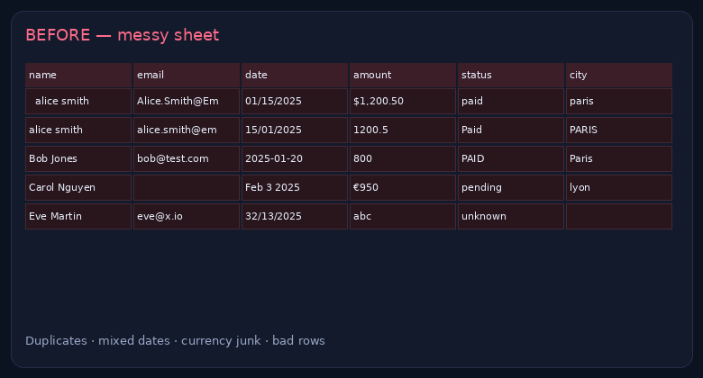

# Messy spreadsheet → clean table + dashboard

> **For non-technical clients — start here**
>
> **What it does:** Takes a messy Excel/CSV (duplicates, weird dates, `$1,200` vs `1200,5`, mixed status) and returns a clean table plus a small summary dashboard.
>
> **Try it (2 steps):**
> 1. Download [`cleanup_demo.xlsx`](./cleanup_demo.xlsx) and open tabs `BEFORE_messy` → `AFTER_clean` → `DASHBOARD`.
> 2. Or run `python clean_demo.py` and open `cleaned_sample.csv`.
>
> **Business benefit:** finance / ops stop fighting the sheet every week. Typical cleanup from **$45** (then $159 / $399 depending on size). Delivery: 1 / 3 / 5 days by tier.



**File:** [cleanup_demo.xlsx](./cleanup_demo.xlsx) · **CSV sample:** [cleaned_sample.csv](./cleaned_sample.csv)  
**Brand:** [Nyyo Automation](https://github.com/nyyoautomation)

[](#)
[](#)
[](#)

---

## What gets fixed

- Mixed date formats → ISO `YYYY-MM-DD`
- Currency symbols / locale decimal commas → float amounts
- Duplicate people (same email) → merged
- Inconsistent status / city casing → normalized
- Bad rows → flagged, not silently deleted

## Run

```bash
python clean_demo.py
```

## What’s for sale

| | |
|---|---|
| **Product** | Cleanup / formulas / light dashboard |
| **From** | **$45 / $159 / $399** |
| **Includes** | Cleaned file · HOWTO · 1 revision · optional Apps Script |

FREE “How to use” tab + change log with every cleanup.

→ Available on LaborX · [Profile & packages](https://github.com/nyyoautomation)

## How to order

Available on LaborX · [Profile & packages](https://github.com/nyyoautomation)

Questions? Ask in your order chat.

